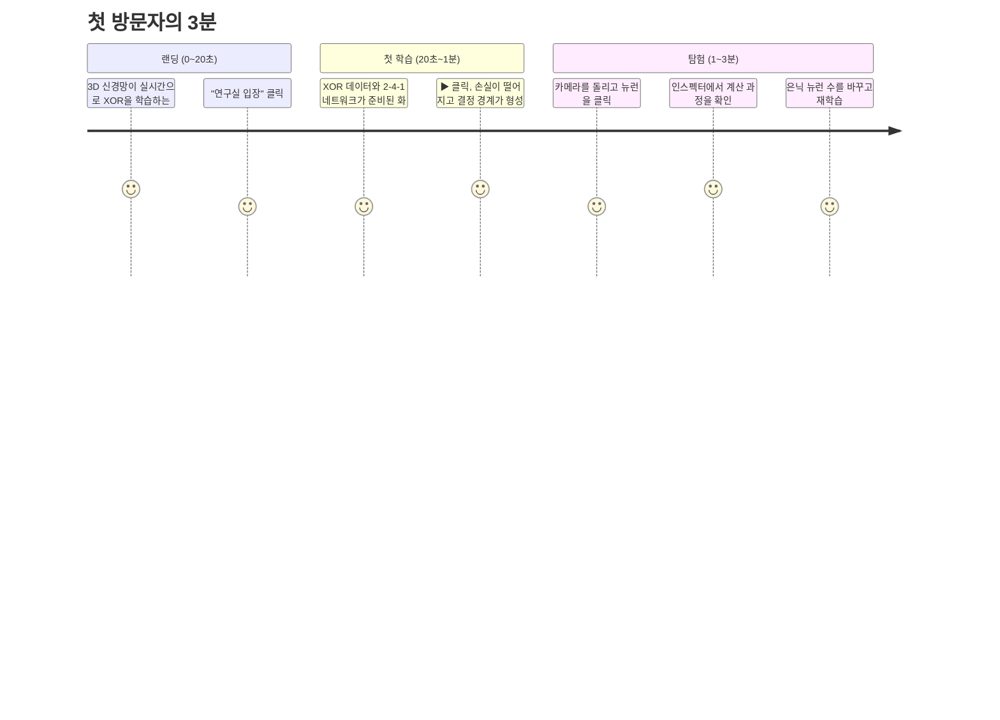

# NEURAL — 제품 명세서 (구체화 기획)

> **슬로건:** Don't just use AI. See how it thinks.
> **문서 상태:** 구체화 기획 v1 — [00-concept.md](./00-concept.md)의 초기 기획안을 기반으로 기능·화면·시각 규칙·범위를 확정한다.
> **관련 문서:** [02-technical-design.md](./02-technical-design.md) (기술 설계) · [03-development-plan.md](./03-development-plan.md) (제작 계획)

---

## 1. 제품 정의

**NEURAL은 브라우저에서 작은 신경망(MLP)을 직접 학습시키고, 그 모델의 실제 내부 상태를 3D 공간에서 탐험하는 인터랙티브 연구실이다.**

### 1.1 제품 원칙

모든 기능과 디자인 결정은 아래 다섯 원칙을 기준으로 판단한다.

| # | 원칙 | 의미 | 판단 예시 |
|---|---|---|---|
| P1 | **보이는 것은 모두 진짜다** | 화면의 모든 색·밝기·두께·움직임은 실제 모델 값에서 나온다. 장식용 가짜 애니메이션은 없다. | 배경 파티클은 허용하지만, 뉴런·연결의 시각 효과는 모두 데이터에 묶인다. |
| P2 | **30초 안에 첫 "아하"** | 첫 방문자가 설명을 읽지 않아도 30초 안에 학습이 진행되는 모습을 본다. | 연구실에 들어가면 XOR 예제가 이미 준비되어 있고 ▶ 한 번이면 학습이 시작된다. |
| P3 | **모든 숫자는 클릭으로 추적된다** | 화면의 어떤 요소든 클릭하면 그 값이 어떻게 계산됐는지 보여 준다. | 뉴런을 누르면 `z = Σwᵢaᵢ + b`의 각 항이 표시된다. |
| P4 | **바꿀 수 있으면 바로 보인다** | 설정 변경 결과는 즉시(≤ 100ms) 시각화에 반영된다. | 학습률 슬라이더를 움직이는 동안에도 학습이 멈추지 않는다. |
| P5 | **조용한 화면, 선명한 데이터** | 발광·움직임은 정보를 강조할 때만 쓴다. | 블룸은 활성도가 높은 뉴런에만 걸리고, 강도는 낮게 유지한다. |

### 1.2 타깃 사용자 (페르소나)

| 페르소나 | 상황 | 원하는 것 | NEURAL이 주는 것 |
|---|---|---|---|
| **지민 — 컴공 2학년** | 수업에서 역전파를 배웠지만 수식만으로는 와닿지 않는다. | "왜 은닉층이 있어야 XOR을 풀 수 있지?"를 직접 확인 | 은닉층을 0개 → 1개로 바꾸며 결정 경계가 달라지는 장면, 뉴런별 응답 맵 |
| **현우 — 백엔드 개발자** | AI를 API로만 써 봤고 내부가 궁금하다. | 짧은 시간에 핵심 개념을 체감 | 가이드 시나리오(학습률·과적합·활성화 함수) |
| **서연 — 채용 담당자 / 기술 리뷰어** | 포트폴리오를 3분 안에 판단해야 한다. | 기술적 완성도를 빠르게 확인 | 랜딩의 라이브 3D 학습 데모, 부드러운 성능, 계산 검증 가능한 인스펙터 |

### 1.3 범위 밖 (Non-goals)

- 대규모 모델(CNN, Transformer) 학습 및 GPU 가속 — v1.0 이후 검토
- 서버 측 학습, 회원 가입, 클라우드 저장
- 일반 ML 프레임워크 대체 (TensorFlow.js 등과 경쟁하지 않는다)
- 모바일에서의 완전한 편집 경험 (모바일은 관람·기본 조작만 지원)

---

## 2. 핵심 사용자 여정

### 2.1 첫 방문 (목표: 3분)



### 2.2 주요 시나리오

1. **관찰:** 데이터셋 선택 → ▶ 학습 → 3D 네트워크의 연결 색·두께와 손실 곡선이 함께 변하는 것을 본다.
2. **추적:** 2D 데이터 캔버스에서 점 하나를 클릭(프로브) → 그 입력이 네트워크를 통과하는 신호 흐름이 재생되고, 출력 뉴런의 예측 확률을 본다.
3. **해부:** 은닉 뉴런 클릭 → 인스펙터에서 입력·가중치·편향·활성화 값과 기여도 순위를 확인한다.
4. **실험:** 층/뉴런 수, 활성화 함수, 학습률을 바꾸거나 데이터 점을 직접 찍고 결과를 비교한다.
5. **되감기:** 타임라인을 드래그해 학습 초기 상태로 돌아가 결정 경계가 어떻게 형성됐는지 다시 본다. 원하는 시점에서 설정을 바꿔 다시 학습(분기)한다.

---

## 3. 정보 구조와 화면 구성

### 3.1 라우트

| 경로 | 화면 | 설명 |
|---|---|---|
| `/` | 랜딩 | 히어로(라이브 3D 학습 데모) · 핵심 기능 3개 소개 · "연구실 입장" CTA |
| `/lab` | 연구실 | 메인 애플리케이션. 모든 기능이 한 화면에서 동작 |
| `/learn/` | 배우기 | 입문 과정: 손으로 만지는 위젯 + 레슨 목록 + 용어 사전 |
| `/lab/?lesson=<id>` | 레슨 | 가이드 레슨이 로드된 연구실 |
| `/lab#c=<config>` | 공유 링크 | URL에 인코딩된 실험 설정 복원 (v1.0) |

### 3.2 연구실 레이아웃 (데스크톱 ≥ 1280px)

> v0.1 이후 디자인 방향을 **Apple.com 스타일의 단순한 밝은 UI**로 바꿨다. 화면에는 핵심만 두고 나머지는 필요할 때 드러낸다(점진적 공개).

```
┌───────────────────────────────────────────────────────────────────────────┐
│ NEURAL                          연구실                                소개 │  ← 반투명 내비게이션
├────────────────┬──────────────────────────────────────────────────────────┤
│ ┌ 데이터 ────┐ │ ┌──────────────────────────────────────────────────────┐ │
│ │ ▣ ▣ ▣ ▣ ▣  │ │ │ Epoch   손실     정확도              ┌ 은닉 1 · N3 ┐ │ │
│ │ ┌────────┐ │ │ │ 370     0.041    98.6%               │ z = Σw·a + b│ │ │
│ │ │결정경계│ │ │ │                                       │ x₂ … −6.07 │ │ │
│ │ └────────┘ │ │ │              3D NEURAL EXPLORER       │ a = −0.988 │ │ │
│ └────────────┘ │ │                                       └────────────┘ │ │
│ ┌ 네트워크 ──┐ │ │                                                      │ │
│ │ 은닉 1 −4+ │ │ │ ● 양수 ● 음수                                         │ │
│ │ tanh|ReLU… │ │ │ 굵기 |w|            ( ↺  ▶  ⏭ | 가중치|기여도 | 보통 ) │ │
│ └────────────┘ │ └──────────────────────────────────────────────────────┘ │
│ ┌ 학습 곡선 ┐  │                                                          │
│ › 고급 설정    │                                                          │
└────────────────┴──────────────────────────────────────────────────────────┘
```

- **사이드바 (304px):** 흰 카드 3개 + 접힌 "고급 설정".
  - 데이터: 데이터셋 썸네일 선택기, 결정 경계 플롯, 프로브 상태
  - 네트워크: 구조 요약(`2 – 4 – 1 · 파라미터 17개`), 은닉층·뉴런 수, 활성화 함수 세그먼트
  - 학습 곡선: 손실/정확도 전환 차트
  - 고급 설정(기본 접힘): 학습률, 옵티마이저, 배치, L2, 샘플 수, 노이즈, 분할 비율, 입력 특성, 새 시드
- **뷰포트 (흰 카드):** 3D가 주인공. 좌상단에 큰 숫자로 Epoch·손실·정확도, 하단 중앙에 떠 있는 재생 바(초기화·재생·1에폭·엣지 모드·속도), 좌하단에 최소 범례.
- **인스펙터:** 뉴런이나 연결을 선택했을 때만 뷰포트 우상단에 떠 있는 카드로 나타난다. 선택이 없으면 공간을 차지하지 않는다.
- **카메라 프리셋:** 화면 버튼 대신 키보드(`1` `2` `3`)와 더블클릭 포커스로 제공한다.

### 3.3 랜딩 페이지

Apple 제품 페이지 구성을 따른다.

1. **히어로:** 가운데 정렬의 큰 헤드라인 "See how it thinks.", 한 줄 소개, 검은 알약형 CTA "연구실 입장"과 파란 텍스트 링크 "더 알아보기 ›". 그 아래 회색 패널 안에서 실제 신경망이 Circle 데이터를 학습하는 라이브 데모.
2. **기능 섹션:** 회색 배경 위 흰 카드 3개(탐험 / 학습 / 계산).
3. **마무리 CTA:** "브라우저 하나면 충분합니다."
4. **푸터:** 기술 스택, 소스 저장소 링크.

---

## 4. 기능 명세

각 기능은 **도입 버전**과 **수용 기준(AC)** 을 함께 정의한다. 버전 정의는 [§7](#7-릴리스-범위)를 참고한다.

### 4.1 3D 신경망 탐험 (Neural Explorer)

**배치 규칙**
- 레이어는 X축 방향으로 입력(왼쪽) → 출력(오른쪽) 순서로 일정 간격(기본 4 유닛)을 두고 배치한다.
- 레이어 내 뉴런은 8개 이하이면 세로 1열, 9개 이상이면 YZ 평면의 정사각형에 가까운 격자로 배치한다.
- 구조가 바뀌면 뉴런은 새 위치로 300ms 동안 보간 이동한다(사라지는 뉴런은 페이드아웃).

**조작**
| 입력 | 동작 |
|---|---|
| 좌클릭 드래그 | 궤도 회전 |
| 우클릭 드래그 / Shift+드래그 | 이동 |
| 휠 / 핀치 | 확대·축소 |
| 호버 | 뉴런·연결 하이라이트 + 툴팁(값 요약) |
| 클릭 | 선택 → 인스펙터 표시, 연결된 엣지만 강조하고 나머지는 흐리게 |
| 더블클릭 | 선택 요소로 카메라 포커스 |
| `1` `2` `3` | 정면 / 측면 / 등각 프리셋 뷰 |
| `Esc` | 선택 해제 |

**표시 모드** (상단 토글, 엣지 인코딩을 전환한다)
- **가중치 모드 (기본):** 엣지 = 가중치 `w`
- **기여도 모드:** 엣지 = 현재 프로브 입력에 대한 기여도 `w · a_src`
- **변화 모드 (v0.2, 구현됨):** 엣지 = 지난 에폭의 평균 기울기의 반대 `−∂L/∂w` — "지금 어디가, 어느 방향으로 학습되고 있는가". 파랑 = 가중치가 커지는 중, 주황 = 작아지는 중

**신호 흐름 애니메이션 (v0.2)**
- 프로브 입력이 바뀌면 입력층 → 출력층 방향으로 레이어 단위 펄스가 이동한다(레이어당 250ms).
- 펄스 밝기 = 해당 엣지 기여도의 크기. 기여도가 상위 30%가 아닌 엣지에는 펄스를 그리지 않는다.
- `prefers-reduced-motion` 환경에서는 애니메이션 없이 최종 상태만 표시한다.

**AC**
- [ ] 6개 은닉층 × 16뉴런(약 100개 뉴런, 1,300개 엣지) 구성에서 기준 노트북 60fps 유지
- [ ] 호버·클릭 대상 판정이 픽셀 단위로 정확하며, 엣지는 화면상 6px 이내 거리에서 선택된다
- [ ] 학습 중에도 카메라 조작이 끊기지 않는다

### 4.2 신경망 학습 (Live Training)

**데이터셋** (모두 2차원 입력, 이진 분류)

| 데이터셋 | 도입 | 특징 | 학습 포인트 |
|---|---|---|---|
| XOR | v0.1 | 4개 사분면, 노이즈 조절 | 선형 분리 불가 → 은닉층의 필요성 |
| Gaussian | v0.1 | 두 개의 가우시안 덩어리 | 선형 분리 가능 → 은닉층 없이도 해결 |
| Circle | v0.1 | 원 안/밖 | 비선형 경계 |
| Moons | v0.2 | 맞물린 반달 | 곡선 경계 |
| Spiral | v0.2 | 두 갈래 나선 | 깊은 네트워크·특성 공학의 효과 |
| Custom | v0.2 | 사용자가 직접 찍은 점 | 실험 공간 연계 |

- 공통 옵션: 샘플 수(50~500), 노이즈(0~0.5), 학습/검증 분할 비율(50~90%), 시드.
- 시드가 같으면 데이터와 초기 가중치가 완전히 동일하게 재현된다.

**하이퍼파라미터**

| 항목 | 값 | 도입 |
|---|---|---|
| 학습률 | 0.0001 ~ 3 (로그 슬라이더) | v0.1 |
| 활성화 함수 | tanh, ReLU, sigmoid, linear | v0.1 |
| 옵티마이저 | SGD, Momentum, Adam | SGD/Adam v0.1, Momentum v0.2 |
| 배치 크기 | 1 ~ 전체 | v0.1 |
| L2 정규화 | 0 ~ 0.1 | v0.2 |
| 입력 특성 | x₁, x₂, x₁², x₂², x₁x₂, sin x₁, sin x₂ | v0.2 |

- 손실 함수: 이진 교차 엔트로피(출력층 sigmoid). 다중 클래스(softmax)는 v1.0 이후 검토.

**제어**
- ▶ 학습 / ⏸ 일시정지 / ⏭ 1스텝(1 에폭) / ↺ 초기화(같은 시드로 가중치 재초기화)
- 속도: 1×(초당 약 10 에폭, 관찰용) ~ 최대(가능한 한 빠르게)
- 학습 중 하이퍼파라미터 변경은 다음 스텝부터 즉시 반영. 구조·데이터 변경은 자동 초기화 후 재시작(확인 없이, 단 타임라인에 이전 기록 보존 — v0.2).

**지표 표시**
- 상단 바: 에폭, 학습 손실, 검증 손실, 정확도, 처리 속도(에폭/초)
- 하단 차트: 학습/검증 손실 곡선(로그 축 전환 가능), 정확도 곡선. 최근 2,000포인트를 표시하고 초과분은 다운샘플링.

**AC**
- [ ] XOR(노이즈 0.1, 200샘플) + 2-4-1 tanh + 학습률 0.1 + Adam 구성이 기본 시드에서 5초 이내 학습 정확도 98% 이상 도달
- [ ] 학습 중 UI 프레임 드랍 없음(학습 연산은 메인 스레드를 막지 않는다)
- [ ] 같은 시드·설정으로 두 번 학습하면 같은 에폭에서 같은 손실 값이 나온다

### 4.3 실험 공간 (Experiment Lab)

**2D 데이터 캔버스** (v0.1: 보기 전용, v0.2: 편집)
- 데이터 점을 클래스 색으로 표시. 학습 데이터는 채운 원, 검증 데이터는 테두리 원.
- 배경에 모델 출력 확률 히트맵(결정 경계)을 표시하고, p = 0.5 등고선을 선으로 그린다.
- **클릭:** 프로브 지정(해당 좌표를 네트워크에 입력해 3D·인스펙터 갱신).
- **편집 모드 (v0.2):** 클릭으로 점 추가(클래스 A/B 전환), 드래그로 이동, 우클릭으로 삭제, 전체 지우기.

**네트워크 편집**
- 은닉층 추가/제거(0~6개), 층별 뉴런 수(1~16)를 +/− 버튼으로 조절.
- 3D 뷰에서 레이어를 선택했을 때 나타나는 플로팅 +/− 버튼으로도 조절 가능(v0.2).

**뉴런 응답 맵 (v0.2)**
- 각 은닉 뉴런이 입력 공간 전체에서 어떻게 반응하는지 작은 히트맵(32×32)으로 계산한다.
- 인스펙터와 3D 뷰(뉴런 옆 빌보드, 토글)에 표시한다. "뉴런 하나하나가 직선/곡선 하나를 맡는다"는 것을 시각적으로 이해시키는 핵심 장치다.

**실험 비교 (v1.0)**
- 현재 실험을 슬롯 A/B에 고정하고, 두 실험의 결정 경계·손실 곡선을 나란히 표시한다.

**AC**
- [ ] 결정 경계 히트맵이 학습 중 초당 10회 이상 갱신된다
- [ ] 점 추가·이동 후 100ms 안에 학습 데이터에 반영된다
- [ ] 은닉층 0개(로지스틱 회귀)로 XOR을 학습하면 정확도가 75%를 넘지 못하는 것(직선 하나로는 분리 불가)을 확인할 수 있다

### 4.4 계산 과정 확인 (Computation Inspector)

**뉴런 선택 시** (v0.1)
```
Layer 1 · Neuron 3          activation: tanh
───────────────────────────────────────────
입력          값       가중치      기여도
x₁         0.80  ×  +1.03   =  +0.82  ████████
x₂        −0.40  ×  +1.02   =  −0.41  ████
편향 b                       =  +0.10  █
───────────────────────────────────────────
z = Σ = 0.51
a = tanh(0.51) = 0.47
```
- 기여도 절댓값 순으로 정렬, 상위 8개 + "나머지 n개 합계" 행으로 표시.
- 값 위에 호버하면 3D 뷰에서 해당 엣지가 강조된다(양방향 연동).
- 프로브 입력이 없으면 데이터셋의 샘플을 1.5초 간격으로 자동 순회하며 값을 보여 준다("샘플 순회" 표시).

**연결 선택 시** (v0.1)
- 출발·도착 뉴런, 가중치 값, 현재 프로브 기여도, 학습 기록상 가중치 변화 스파크라인.

**역전파 보기 (v1.0)**
- 선택 뉴런의 `δ = ∂L/∂z`, 각 가중치 기울기 `∂L/∂w = δ · a_src`, 업데이트량 `−η · ∂L/∂w`를 같은 표 형식으로 표시한다.

**AC**
- [ ] 인스펙터에 표시된 `z`, `a` 값이 엔진 순전파 결과와 소수점 6자리까지 일치한다(자동 테스트)
- [ ] 인스펙터의 값과 3D 인코딩이 같은 데이터 스냅샷에서 나온다(프레임 간 불일치 없음)

### 4.5 학습 상태 기록 및 재생 (Time Travel)

**기록 정책** (v0.2, 구현됨)
- 5 에폭마다 스냅샷을 저장하고, 200개를 넘으면 정기 스냅샷을 하나 걸러 지우고 간격을 2배로 늘린다(전 구간을 고르게 덮으면서 메모리 상한 유지). *초기안의 로그 간격은 짧은 학습에서 너무 성겨 바꿨다.*
- 손실이 직전 스냅샷 대비 20% 이상 감소하면 "이벤트 스냅샷"을 추가로 저장하고 타임라인에 마커로 표시.
- 스냅샷 = 파라미터 + 옵티마이저 상태 + 난수 상태 + 배치 순서(최대 구성에서도 약 35KB × 200개).

**재생** — 별도 타임라인 바 대신 **학습 곡선 자체가 타임라인**이다. 곡선 아래 점이 기록 시점(진한 점 = 이벤트)이고, 곡선을 누르거나 끌면 그 시점으로 간다. ←/→ 키로 이동, Esc로 복귀.
- 타임라인 스크러버를 드래그하면 학습이 일시정지되고 해당 시점의 가중치로 3D·결정 경계·인스펙터가 모두 바뀐다.
- "현재로 돌아가기" 버튼으로 최신 상태 복귀.
- **분기:** 과거 시점에서 ▶를 누르면 그 시점부터 다시 학습한다. 이후 기록은 회색 "이전 가지"로 남아 비교할 수 있다(v1.0). v0.2에서는 확인 후 이후 기록을 잘라낸다.

**비교 (v1.0)**
- 두 스냅샷을 선택하면 3D 뷰의 엣지가 가중치 변화량 `Δw`로 표시된다.

**AC**
- [ ] 스크러빙 중 시각화 갱신 지연 100ms 이하
- [ ] 과거 시점에서 재개한 학습이, 처음부터 같은 시점까지 학습한 뒤 이어서 학습한 결과와 동일하다(옵티마이저 상태·난수 상태 포함 저장)

### 4.6 가이드 레슨 (v0.2로 앞당김)

초기 기획의 "교육용 도구로 발전" 방향을 구체화한 기능. `/lab/?lesson=<id>`로 열면 연구실 설정이 레슨에 맞게 준비되고, 사이드바 맨 위의 레슨 카드가 단계를 안내한다.

- **단계 구성:** 제목 · 쉬운 설명 · "할 일" 한 가지 · 강조할 화면 영역(파란 테두리 스포트라이트)
- **완료 감지:** 할 일은 실제 상태로 판정한다(예: 정확도 ≥ 95%, 은닉층 추가, 학습률 변경 후 초기화). 완료 전에는 "다음"이 잠기고 "건너뛰기"를 제공한다.

| 레슨 | 내용 | 확인되는 현상 (엔진으로 검증) |
|---|---|---|
| 연구실 둘러보기 | 데이터·신경망·지표 보는 법, 첫 학습, 뉴런 클릭 | 기본 XOR 약 3~4초 수렴 |
| 선 하나로 안 될 때 | XOR에서 은닉층의 필요성 | 은닉층 0개: 정확도 약 65%에서 정체 → 1개: 95% 이상 |
| 힌트를 주면 쉬워져요 | 입력 특성(x², 특성 공학) | Circle 은닉층 0개: 약 70% → x₁², x₂² 추가: 100% |
| 학습률: 보폭 정하기 | 너무 큰/작은/알맞은 학습률 | 3: 발산(손실 널뜀) · 0.0001: 300 에폭에도 약 69% · 0.03: 수렴 |
| 외우기와 이해하기 | 과적합과 L2 정규화 | 큰 네트워크: 학습 100% / 검증 약 77% → L2 0.01: 검증 약 87% |

### 4.8 입문자 경험 (신규)

AI를 처음 다뤄 보는 사람이 막히지 않도록 다음을 제공한다.

- **배우기 페이지 (`/learn/`):** 코드·수학 없이 10분 과정.
  1. 예시로 배워요 — 예시 · 모델 · 학습의 관계
  2. **뉴런 하나 놀이터** — w₁, w₂, b 슬라이더로 직접 경계선을 움직이고, "한 걸음 배우기"로 경사 하강이 각 값을 얼마나(▲▼) 고치는지 본다. 미션 3개(움직여 보기 · 100% 만들기 · 컴퓨터에게 맡기기)
  3. **손실 골짜기** — 공(가중치)을 기울기 따라 굴려 보며 학습률이 작을 때·알맞을 때·너무 클 때를 비교
  4. 층 쌓기 — XOR 그림과 은닉층 설명, 연구실 레슨으로 연결
  5. 레슨 목록, 용어 사전
- **첫 방문 환영 대화상자:** "3분 투어 시작 / 기초부터 배우기 / 바로 실험" 중 선택. 한 번만 표시
- **용어 설명:** 점선 밑줄이 있는 용어(Epoch, 손실, 학습률 등 19개)에 마우스를 올리거나 포커스하면 쉬운 설명이 뜬다
- **지금 무슨 일이?:** 지표 아래 한 문장으로 상태를 알려 준다. 예: "아직은 찍는 수준이에요", "더 나아지지 않고 멈췄어요. 은닉층이나 뉴런을 늘려 보세요", "과적합일 수 있어요", "학습률이 너무 큰 것 같아요"
- **인스펙터 쉬운 요약:** 숫자 표 위에 "이 입력에서 +쪽(파랑)으로 반응해요. 영향이 가장 큰 입력: x₂" 같은 문장과 뉴런 **응답 맵**을 보여 준다
- **직접 데이터 그리기:** "점 찍기" 모드에서 클릭으로 점 추가, Shift+클릭으로 삭제. 데이터를 바꿔도 가중치는 유지되어 학습이 이어진다
- **자동 저장:** 마지막 실험 설정을 브라우저에 저장해 다시 열면 이어서 할 수 있다

### 4.7 저장과 공유 (구현됨)

- **자동 저장:** 마지막 실험 설정을 브라우저 로컬 저장소에 저장하고 재방문 시 복원.
- **실험 저장:** 이름을 붙여 최대 20개까지 로컬(localStorage)에 저장 — 설정 + 데이터 + 가중치(타임라인은 저장하지 않음).
- **공유 링크:** 설정과 시드(필요 시 사용자 데이터 점)를 압축해 URL 해시에 인코딩. 링크를 연 사람은 같은 시드로 같은 학습을 재현한다.

---

## 5. 시각 인코딩 규칙 (단일 기준표)

"시각화가 실제 계산 상태를 일관되게 반영하는가"(성공 기준)를 보장하기 위해, 모든 시각 요소의 데이터 대응을 이 표 하나로 정의한다. 구현은 이 표를 그대로 옮긴 **인코딩 함수 모듈**을 공유하며, 3D·2D·인스펙터가 모두 같은 함수를 사용한다.

| 요소 | 시각 채널 | 데이터 | 정규화 |
|---|---|---|---|
| 뉴런 | 색상(hue) | 활성화 부호 (+: 청록, −: 주황) | sigmoid는 0.5를 중심으로 간주 |
| 뉴런 | 색 농도 | 활성화 크기 `|a|` | tanh/sigmoid: 이론 범위, ReLU: 레이어별 최근 p95 |
| 뉴런 | 외곽 링 | 편향 `b` 부호·크기 | 네트워크 전체 `max|b|` |
| 뉴런 | 크기 | 고정 (인코딩 없음) | — 크기는 위계 표현에만 사용(입력/출력층은 약간 큼) |
| 엣지 | 색상 | 표시 모드 값의 부호 | — |
| 엣지 | 두께 + 불투명도 | 표시 모드 값의 크기 | 네트워크 전체 `max|값|`, 하위 5%는 거의 투명 |
| 펄스 | 밝기 | 기여도 크기 `|w·a|` | 레이어별 최대값 |
| 결정 경계 | 배경 색 | 출력 확률 p | 0~1, 0.5에서 중립색 |

- **색상 팔레트:** 양수 = `#0071E3`(파랑), 음수 = `#F56300`(주황), 0 = `#E8E8ED`(옅은 회색). 흰 배경에서 크기가 클수록 색이 진해진다. 적록 색각 이상에서도 구분되는 청-주황 대비를 사용한다.
- 밝은 배경에서는 가산 발광이 보이지 않으므로 뉴런 밝기 대신 **색 농도**로 |a|를 표현하고, 선택되지 않은 요소는 흰색 쪽으로 흐리게 한다.
- **범례:** 3D 뷰 좌하단에 현재 모드의 범례(색 의미 + 정규화 기준값)를 항상 표시한다.

---

## 6. 디자인 시스템

v0.1 이후 Apple.com 스타일로 정했다. 원칙은 **여백, 큰 숫자, 적은 선, 필요한 순간에만 나타나는 UI**다.

| 항목 | 정의 |
|---|---|
| 배경 | 페이지 `#F5F5F7`, 카드·3D 뷰 `#FFFFFF`. 테두리 대신 배경 대비와 부드러운 그림자로 영역을 나눈다 |
| 텍스트 | 기본 `#1D1D1F`, 보조 `#6E6E73`, 3차 `#86868B`, 링크 `#0066CC` |
| 강조 | 주요 버튼은 검은 알약형(`#1D1D1F`). 파랑은 데이터(양수)와 텍스트 링크에만 쓴다 |
| 서체 | 시스템 서체(SF Pro / Apple SD Gothic Neo), 그 외 환경은 Pretendard. 숫자는 `tabular-nums` |
| 모서리 | 카드 18px, 컨트롤 8~12px, 버튼·스테퍼는 완전한 알약형 |
| 컨트롤 | 세그먼트 컨트롤(흰 썸), 알약형 스테퍼, 흰 썸 슬라이더, 반투명(블러) 떠 있는 패널 |
| 숫자 표기 | 고정 소수점 3자리, 부호 항상 표시(`+0.820`) |
| 모션 | 200~300ms ease. 데이터 갱신은 보간 없이 즉시, 구조 변경과 패널 등장만 보간 |
| 점진적 공개 | 자주 쓰지 않는 설정은 "고급 설정"에 접고, 인스펙터는 선택 시에만 표시 |

**접근성**
- 모든 컨트롤 키보드 조작 가능, 포커스 링 표시
- 텍스트 대비 WCAG AA 이상
- `prefers-reduced-motion` 존중
- 3D 뷰의 선택 정보는 인스펙터에서 텍스트로 동일하게 제공(스크린리더 대체 경로)

---

## 7. 릴리스 범위

초기 기획 §7의 "초기 버전 핵심 범위" 5개 항목을 v0.1(MVP)로, 후속 확장 후보를 v0.2/v1.0으로 배분했다.

| 기능 | v0.1 MVP | v0.2 Lab | v1.0 Public | 이후 |
|---|---|---|---|---|
| 3D 구조 시각화 · 카메라 | ● | | | |
| 뉴런/연결 선택 · 툴팁 | ● | | | |
| 가중치·기여도 모드 | ● | 기울기 모드 | | |
| 신호 흐름 애니메이션 | | ● | | |
| 데이터셋 | XOR·Gaussian·Circle | Moons·Spiral·Custom | | 다중 클래스, 회귀 |
| 학습 제어 · 하이퍼파라미터 | ● (SGD/Adam) | Momentum·L2·특성 | | |
| 손실/정확도 차트 | ● | | | |
| 결정 경계 히트맵 | ● (보기) | 데이터 편집 ● | A/B 비교 | |
| 네트워크 구조 편집 | ● (패널) | 3D 내 편집 | | |
| 인스펙터 (순전파) | ● | | 역전파 | |
| 뉴런 응답 맵 | | ● (인스펙터) | 3D 빌보드 | |
| Time Travel | | 기록·재생·재개 | 분기·Δw 비교 | |
| 가이드 레슨 · 배우기 페이지 | | ● | 추가 레슨 | |
| 랜딩 페이지 | 간단 | | 완성 | |
| 저장·공유 | | 로컬 자동 저장 | 실험 저장·URL 공유 | |
| 모바일 관람 모드 | | | ● | |
| MNIST 손글씨 / WebGPU | | | | ● |

---

## 8. 성공 지표

초기 기획 §9의 정성 기준을 측정 가능한 지표로 바꾸었다.

| 초기 기준 | 측정 지표 | 목표 (v0.1) |
|---|---|---|
| 구조를 쉽게 탐색하고 정보를 확인할 수 있는가 | 첫 방문 사용성 테스트(5명)에서 안내 없이 뉴런 정보 확인까지 걸린 시간 | 중앙값 ≤ 60초 |
| 학습에 따라 파라미터와 결과가 실제로 변하는가 | XOR 기본 설정 수렴 시간 / 재현성 테스트 | ≤ 5초, 동일 시드 100% 재현 |
| 시각화가 계산 상태를 일관되게 반영하는가 | 인코딩·인스펙터 값 일치 자동 테스트, 기울기 수치 검증 | 테스트 100% 통과, 기울기 상대오차 < 1e-6 |
| 설정을 바꾸고 차이를 관찰할 수 있는가 | 설정 변경 → 시각화 반영 지연 | ≤ 100ms |
| 노트북에서 원활히 동작하는가 | 기준 기기(내장 GPU 노트북, 1080p)에서 최대 구성 FPS / 초기 로딩 | ≥ 60fps(최소 45), JS ≤ 500KB(gzip), LCP ≤ 2.5초 |

---

## 9. 리스크와 대응

| 리스크 | 영향 | 대응 |
|---|---|---|
| 3D가 화려하지만 정보 전달력이 낮아짐 | 핵심 가치 훼손 | 시각 인코딩 기준표(§5) 준수, 2D 결정 경계를 항상 함께 표시, 사용성 테스트로 검증 |
| 엣지가 많아지면 화면이 복잡해짐 | 가독성 저하 | 최대 16뉴런/층 제한, 작은 값 엣지 투명화, 선택 시 비관련 요소 흐리기 |
| 학습 연산이 렌더링을 방해 | 끊김 | 학습을 Web Worker로 분리, 메인 스레드로 보내는 상태는 초당 30회로 제한 |
| ReLU 등 범위가 없는 값의 정규화가 오해를 부름 | 잘못된 해석 | 범례에 정규화 기준값 명시, 인스펙터에는 항상 원값 표시 |
| 범위 확대로 일정 지연 | 출시 지연 | v0.1 범위 고정, 신규 아이디어는 백로그로만 추가 |
