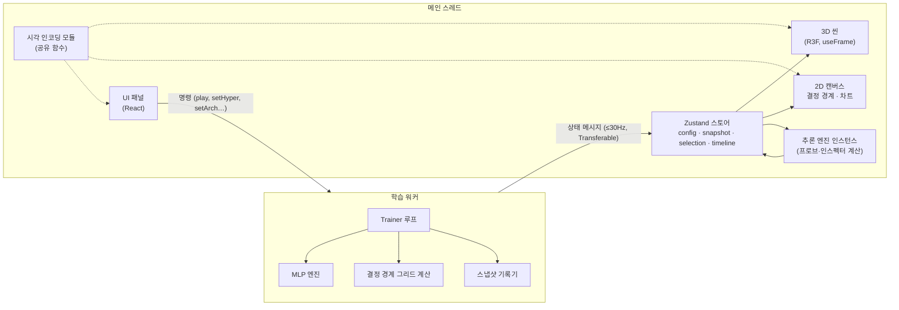

# NEURAL — 기술 설계서

> **문서 상태:** 기술 설계 v1
> **관련 문서:** [01-product-spec.md](./01-product-spec.md) (제품 명세) · [03-development-plan.md](./03-development-plan.md) (제작 계획)

---

## 1. 기술 스택 결정

| 영역 | 선택 | 근거 | 검토했던 대안 |
|---|---|---|---|
| 빌드·앱 | **Vite + React 18 + TypeScript** | 서버가 필요 없는 순수 클라이언트 앱. Web Worker 번들링이 간단하고, Three.js의 SSR 회피 처리가 필요 없다. 정적 호스팅으로 배포 | Next.js — 랜딩 SEO 이점은 있으나 3D·Worker 코드 전부를 클라이언트 전용으로 감싸야 해 이점이 작다. 블로그·문서 페이지가 필요해지면 재검토 |
| 3D | **three + @react-three/fiber + @react-three/drei** | 선언적 씬 구성 + 필요한 곳은 저수준 제어 가능 | 순수 Three.js — 패널 UI와의 상태 연동 코드가 늘어난다 |
| 후처리 | **@react-three/postprocessing** (Bloom) | 선택적 발광 | 직접 구현 |
| 상태 관리 | **Zustand** | 렌더 루프에서 구독 없이 `getState()`로 읽을 수 있어 고빈도 갱신에 적합 | Redux Toolkit — 보일러플레이트 과다 |
| 신경망 | **직접 구현 (순수 TS, 의존성 없음)** | 내부 계산을 모두 노출해야 하며(트레이스, 기여도, 기울기), 모델이 작아 성능 문제가 없다 | TensorFlow.js — 내부 값 추출이 번거롭고 번들이 크다 |
| 연산 분리 | **Web Worker + 타입 지정 메시지 프로토콜** | 학습·결정 경계 계산이 렌더링을 막지 않게 한다 | SharedArrayBuffer — COOP/COEP 헤더가 필요해 호스팅 제약. 필요 시 최적화 단계에서 도입 |
| 차트 | **Canvas 2D 자체 구현** (손실 곡선·히트맵) | 실시간 갱신이 많고 요구가 단순. 번들 절약 | uPlot — 기능이 더 필요해지면 교체 |
| UI 스타일 | **CSS Modules + CSS 변수(디자인 토큰)** | 패널 수가 적고 커스텀 디자인 비중이 크다 | Tailwind — 팀 선호에 따라 교체 가능 |
| 저장 | localStorage(설정), IndexedDB via `idb-keyval`(실험) | 초기 기획의 "브라우저 로컬 저장 우선" | — |
| 테스트 | **Vitest**(단위), **Playwright**(E2E·시각 회귀) | Vite 생태계와 일체 | Jest |
| 품질 | ESLint, Prettier, `tsc --noEmit`, GitHub Actions CI | | |
| 배포 | **Vercel** 또는 GitHub Pages (정적) | PR별 프리뷰 배포 | Netlify |

---

## 2. 아키텍처 개요



**핵심 설계 원칙**

1. **엔진은 순수하다.** `core/` 아래 코드는 DOM·React·Three.js를 모른다. 같은 엔진이 워커(학습)와 메인 스레드(추론·인스펙터)에서 동시에 쓰인다.
2. **단일 진실 공급원.** 메인 스레드가 그리는 모든 것은 워커가 보낸 마지막 *스냅샷*(파라미터 버퍼 + 지표)에서 파생된다. 인스펙터와 3D가 같은 스냅샷을 읽으므로 값이 어긋날 수 없다.
3. **React는 구조만, 값은 프레임 루프에서.** 레이어 구성이 바뀔 때만 React가 다시 렌더링하고, 가중치·활성화 같은 고빈도 값은 `useFrame`에서 스토어를 직접 읽어 GPU 버퍼를 갱신한다.
4. **결정론.** 모든 난수는 시드 기반 PRNG(mulberry32)에서 나오고, 난수 상태도 스냅샷에 포함한다.

---

## 3. 디렉터리 구조

```
neural/
├─ docs/                      # 기획·설계 문서
├─ public/
├─ src/
│  ├─ core/                   # 순수 TS — DOM/React 의존 금지 (ESLint로 강제)
│  │  ├─ nn/
│  │  │  ├─ model.ts          # MLP 정의, 파라미터 레이아웃, forward/backward
│  │  │  ├─ activations.ts    # tanh, relu, sigmoid, linear (+ 도함수)
│  │  │  ├─ loss.ts           # binary cross-entropy
│  │  │  ├─ optimizers.ts     # SGD, Momentum, Adam (상태 직렬화 포함)
│  │  │  ├─ init.ts           # Xavier/He 초기화
│  │  │  └─ trace.ts          # 프로브 입력의 레이어별 z, a, 기여도 계산
│  │  ├─ data/
│  │  │  ├─ datasets.ts       # xor, gaussian, circle, moons, spiral
│  │  │  ├─ features.ts       # x², x₁x₂, sin 등 입력 특성 변환
│  │  │  └─ split.ts
│  │  ├─ rng.ts               # 시드 PRNG
│  │  └─ timeline.ts          # 스냅샷 정책·솎아내기
│  ├─ worker/
│  │  ├─ protocol.ts          # 명령/이벤트 타입 (메인·워커 공유)
│  │  ├─ trainer.worker.ts    # 학습 루프
│  │  └─ client.ts            # 메인 스레드 측 래퍼
│  ├─ state/
│  │  └─ store.ts             # Zustand 슬라이스: config, live, selection, timeline, ui
│  ├─ viz/
│  │  ├─ encoding.ts          # ★ 시각 인코딩 기준표 구현 (제품 명세 §5)
│  │  ├─ layout.ts            # 레이어·뉴런 3D 좌표 계산
│  │  ├─ three/
│  │  │  ├─ NetworkScene.tsx
│  │  │  ├─ Neurons.tsx       # InstancedMesh
│  │  │  ├─ Edges.tsx         # 인스턴스 리본 + 커스텀 셰이더
│  │  │  ├─ Pulses.tsx        # 신호 흐름
│  │  │  ├─ picking.ts        # 뉴런 레이캐스트 + 엣지 화면 거리 판정
│  │  │  └─ CameraRig.tsx
│  │  └─ canvas2d/
│  │     ├─ DecisionBoundary.tsx
│  │     ├─ LossChart.tsx
│  │     └─ ResponseMap.tsx
│  ├─ ui/                     # 패널·컨트롤·인스펙터·타임라인 컴포넌트
│  ├─ pages/
│  │  ├─ Landing.tsx
│  │  └─ Lab.tsx
│  ├─ styles/tokens.css       # 디자인 토큰
│  └─ main.tsx
├─ tests/
│  ├─ unit/                   # Vitest (core, encoding, timeline)
│  └─ e2e/                    # Playwright
└─ .github/workflows/ci.yml
```

---

## 4. 신경망 엔진 설계 (`core/nn`)

### 4.1 파라미터 레이아웃

모든 가중치와 편향을 **하나의 `Float64Array`** 에 연속 저장하고, 레이어별 뷰(offset, 길이)로 접근한다.

```
params: [ W₁(n₀×n₁) | b₁(n₁) | W₂(n₁×n₂) | b₂(n₂) | … ]
grads:  같은 레이아웃
```

- **이점:** 스냅샷 = 버퍼 1회 복사, 워커 ↔ 메인 전송 = Transferable 1개, 옵티마이저 = 평탄한 배열 위의 단일 루프.
- 엣지 인덱스 `e`와 파라미터 인덱스가 1:1로 대응하므로 3D 엣지 인스턴스 속성도 같은 순서로 채운다.
- Float64를 쓰는 이유: 수치 기울기 검증 정확도, JS 숫자와의 일관성. GPU로 보낼 때만 Float32로 변환한다(엣지 1,300개 수준이라 비용 무시 가능).

### 4.2 주요 인터페이스

```ts
interface ModelSpec {
  inputFeatures: FeatureId[];   // ['x1','x2'] 등
  hidden: number[];             // 예: [4, 4]
  activation: ActivationId;     // 은닉층 공통
  output: 'sigmoid';
}

interface Model {
  spec: ModelSpec;
  layout: LayerView[];          // { wOffset, bOffset, inSize, outSize }
  params: Float64Array;
}

forward(model, x: Float64Array, ws: Workspace): number;               // 확률 p
forwardTrace(model, x): Trace;     // 레이어별 z[], a[] (인스펙터·프로브용)
backward(model, batch, ws): { loss: number; grads: Float64Array };
predictGrid(model, res: number, bounds): Float32Array;                // 결정 경계
neuronGrid(model, layer, neuron, res, bounds): Float32Array;          // 응답 맵
```

- `Workspace`는 순전파 중간값 버퍼를 미리 할당해 두고 재사용한다(학습 루프에서 GC 발생 0 목표).
- 기여도는 별도 저장하지 않고 `w[i,j] · a_src[i]`로 필요할 때 계산한다.

### 4.3 검증 전략

- **수치 기울기 검사:** 무작위 구조·입력 50종에 대해 중앙 차분 `(L(θ+ε) − L(θ−ε)) / 2ε` 과 해석적 기울기의 상대오차 < 1e-6.
- **수렴 테스트:** XOR / Circle 기본 설정이 고정 시드에서 N 에폭 안에 목표 정확도 도달.
- **결정론 테스트:** 같은 시드 2회 학습 → 파라미터 버퍼 비트 단위 일치.
- **재개 테스트:** 스냅샷 복원 후 K 에폭 학습 결과 = 중단 없이 학습한 결과.

---

## 5. 워커 프로토콜 (`worker/protocol.ts`)

```ts
// 메인 → 워커
type Command =
  | { type: 'init'; spec: ModelSpec; data: DatasetConfig | CustomPoints; hyper: Hyper; seed: number }
  | { type: 'play' } | { type: 'pause' } | { type: 'step'; epochs: number }
  | { type: 'reset'; seed?: number }
  | { type: 'setHyper'; hyper: Partial<Hyper> }
  | { type: 'setData'; data: DatasetConfig | CustomPoints }
  | { type: 'setSpec'; spec: ModelSpec }
  | { type: 'setSpeed'; epochsPerSecond: number | 'max' }
  | { type: 'restore'; snapshotId: number }
  | { type: 'requestResponseMaps'; layer: number }

// 워커 → 메인
type Event =
  | { type: 'state'; epoch: number; params: Float64Array; metrics: Metrics; gradMag?: Float32Array }
  | { type: 'boundary'; epoch: number; grid: Float32Array; res: number }
  | { type: 'responseMaps'; layer: number; maps: Float32Array; res: number }
  | { type: 'snapshot'; meta: SnapshotMeta }      // 타임라인 마커용 메타만 전송
  | { type: 'error'; message: string }
```

**학습 루프 스케줄링**
- 워커는 `setTimeout(0)` 기반 루프에서 시간 예산(예: 8ms) 동안 에폭을 반복 실행한다. 사이사이 명령 메시지를 처리하므로 일시정지·하이퍼 변경이 즉시 반영된다.
- `state` 이벤트는 최대 30Hz, `boundary`는 최대 10Hz(그리드 64×64, 필요 시 100×100)로 제한한다.
- 1× 속도 모드에서는 에폭 간 지연을 넣어 관찰 가능한 속도(초당 약 10 에폭)로 맞춘다.
- 스냅샷 본문(파라미터·옵티마이저 상태·RNG 상태)은 워커에 보관하고, 메인 스레드는 메타만 받는다. 스크러빙 시 `restore` 명령으로 해당 파라미터를 `state` 이벤트로 받아 그린다.

---

## 6. 렌더링 설계 (`viz/three`)

### 6.1 뉴런
- `InstancedMesh`(구 지오메트리, 저폴리) 1개로 전체 뉴런을 그린다.
- 인스턴스 속성: 위치(구조 변경 시만 갱신), 색·발광(매 프레임 갱신).
- 선택은 `InstancedMesh` 레이캐스트의 `instanceId`로 판정.

### 6.2 엣지
- WebGL의 `lineWidth`는 1px로 고정되는 환경이 많아 쓰지 않는다.
- **인스턴스 리본**: 사각형 하나를 인스턴스로 복제하고, 정점 셰이더에서 시작점·끝점·두께 속성으로 카메라를 향하는 띠를 만든다. 두께·색·불투명도·하이라이트는 인스턴스 속성으로 전달한다.
- 투명도 정렬 문제를 피하기 위해 가산 혼합(additive blending) + `depthWrite: false`를 사용한다.
- **피킹:** 엣지 1,300개 수준이므로 CPU에서 화면 좌표로 투영한 선분과 마우스 사이 거리(≤ 6px)를 계산한다. 마우스 이동 시에만 실행.

### 6.3 펄스 (신호 흐름)
- 엣지 인스턴스 셰이더에 `uTime`, `uLayerPhase`를 전달하고, 엣지 위의 위치 `t`에서 밝은 점이 이동하도록 조각 셰이더로 그린다(추가 지오메트리 없음).

### 6.4 프레임 갱신 흐름

```
useFrame(() => {
  const s = store.getState();
  if (s.live.version === lastVersion) return;    // 새 스냅샷이 없으면 생략
  trace = forwardTrace(model(s.live.params), s.probe.x)   // 메인 스레드 추론
  encoding.neurons(trace, s.config) → neuronColorAttr
  encoding.edges(s.live.params, trace, s.ui.edgeMode) → edgeAttrs
  mark attributes needsUpdate
})
```

### 6.5 성능 예산

| 항목 | 예산 |
|---|---|
| 프레임 시간 (최대 구성, 기준 노트북) | ≤ 16ms (메인 스레드 JS ≤ 4ms) |
| 드로우 콜 | ≤ 10 (뉴런 1 + 엣지 1 + 링 1 + 라벨 + 후처리) |
| 학습 처리량 (2-8-8-1, 200샘플, 전체 배치) | ≥ 500 에폭/초 (워커) |
| 결정 경계 그리드 64×64 | ≤ 5ms (워커) |
| 초기 JS 번들 | ≤ 500KB gzip — 랜딩/연구실 코드 분할 |

---

## 7. 상태 모델 (`state/store.ts`)

| 슬라이스 | 내용 | 갱신 빈도 |
|---|---|---|
| `config` | ModelSpec, Hyper, DatasetConfig, seed | 사용자 조작 시 |
| `live` | 최신 params, metrics, version, boundary grid | ≤ 30Hz |
| `history` | 지표 시계열(다운샘플링 링 버퍼) | ≤ 30Hz |
| `probe` | 프로브 입력 좌표, 자동 순회 여부 | 사용자 조작 / 1.5초 |
| `selection` | `{kind: 'neuron', layer, index}` \| `{kind: 'edge', paramIndex}` \| null | 사용자 조작 |
| `timeline` | 스냅샷 메타 목록, 재생 위치, 재생 중 여부 | 스냅샷 시 |
| `ui` | 엣지 모드, 패널 열림 상태, 응답 맵 토글 | 사용자 조작 |

- 고빈도 슬라이스(`live`, `history`)는 React 컴포넌트에서 직접 구독하지 않는다. 숫자 표시 컴포넌트는 `requestAnimationFrame` 주기로 셀렉터를 폴링해 텍스트만 바꾼다.

---

## 8. 테스트·품질 전략

| 레벨 | 도구 | 대상 | 예시 |
|---|---|---|---|
| 단위 | Vitest | `core/`, `viz/encoding.ts`, `viz/layout.ts`, `core/timeline.ts` | 기울기 검사, 결정론, 인코딩 경계값(0, ±max, NaN) |
| 통합 | Vitest + worker 모의 | 워커 프로토콜 | `step` 명령 후 `state` 이벤트 순서·내용 |
| E2E | Playwright (Chromium) | 주요 사용자 여정 | 연구실 진입 → ▶ → 5초 내 정확도 ≥ 98% 표시 → 뉴런 클릭 → 인스펙터 표시 |
| 시각 회귀 | Playwright 스크린샷 | 3D 뷰·패널 | 고정 시드·고정 카메라에서 픽셀 비교(허용 오차 설정) |
| 성능 | Playwright + `performance` API | 최대 구성 FPS | CI에서는 경향만 기록, 기준 기기에서 수동 측정 |

**CI 파이프라인 (PR마다):** `lint` → `typecheck` → `test:unit` → `build` → `test:e2e` → 프리뷰 배포.

---

## 9. 주요 기술 리스크와 사전 검증(스파이크)

| 리스크 | 스파이크 | 시점 |
|---|---|---|
| 인스턴스 리본 엣지 셰이더의 품질·성능 | 1,300개 엣지 + 매 프레임 속성 갱신 60fps 확인 | M2 첫 이틀 |
| 워커 ↔ 메인 30Hz 전송 시 GC·지연 | Transferable 왕복 + 버퍼 풀 재사용 측정 | M3 첫날 |
| 블룸 후처리 비용(내장 GPU) | 블룸 on/off FPS 비교, 저사양 자동 비활성화 기준 결정 | M7 |
| Safari WebGL2·Worker 모듈 호환 | 최신 Safari에서 스모크 테스트 | M3, M7 |
