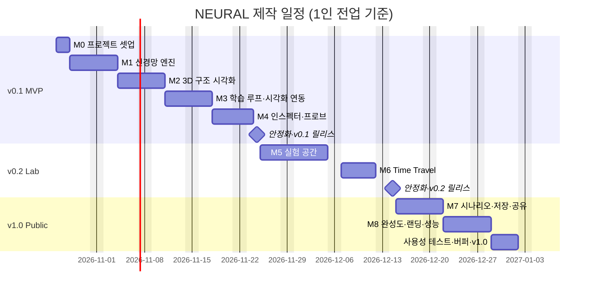

# NEURAL — 제작 계획서

> **문서 상태:** 제작 계획 v1
> **관련 문서:** [01-product-spec.md](./01-product-spec.md) (제품 명세) · [02-technical-design.md](./02-technical-design.md) (기술 설계)
> **가정:** 개발자 1인 전업 기준(주 5일). 파트타임이면 일정을 약 2배로 잡는다. 공휴일은 반영하지 않았다.

---

## 1. 전체 로드맵

| 릴리스 | 목표 | 포함 마일스톤 | 기간 | 예상 완료 |
|---|---|---|---|---|
| **v0.1 MVP** | 초기 기획 §7의 핵심 범위 5개 검증 — "실제 계산과 3D가 연결되어 있다" | M0 ~ M4 | 약 4.5주 | 2026-11-24 |
| **v0.2 Lab** | 직접 실험하고 되감는 경험 — 데이터 편집, 응답 맵, Time Travel | M5 ~ M6 | 약 3주 | 2026-12-14 |
| **v1.0 Public** | 처음 온 사람도 배우고 공유할 수 있는 완성품 | M7 ~ M8 | 약 3주 | 2027-01-01 |

---

## 2. 마일스톤 상세

각 마일스톤은 **작업 → 산출물 → 완료 조건**으로 정의한다. 완료 조건을 모두 만족해야 다음 마일스톤으로 넘어간다.

### M0. 프로젝트 셋업 (2일)

**작업**
- [ ] Vite + React + TypeScript 프로젝트 생성, 절대 경로 별칭(`@core`, `@viz`, …)
- [ ] ESLint(+ `core/`에서 DOM·React import 금지 규칙), Prettier, `tsc --noEmit`
- [ ] Vitest, Playwright 설정 및 예제 테스트
- [ ] GitHub Actions CI: lint → typecheck → unit → build → e2e
- [ ] 정적 배포 파이프라인(Vercel 또는 GitHub Pages) + PR 프리뷰
- [ ] 디자인 토큰(`styles/tokens.css`), 폰트, 기본 레이아웃 셸(상단 바 / 좌·우·하단 패널 / 중앙 뷰포트 빈 상태)

**완료 조건**
- `main` 브랜치 푸시 시 CI 통과 후 자동 배포되고, 빈 연구실 레이아웃이 배포 URL에서 보인다.

### M1. 신경망 엔진 (5일)

**작업**
- [ ] `rng.ts` — mulberry32 시드 PRNG, 상태 직렬화
- [ ] `activations.ts`, `loss.ts`, `init.ts`
- [ ] `model.ts` — 평탄 파라미터 레이아웃, `forward`, `backward`, Workspace 재사용
- [ ] `optimizers.ts` — SGD, Adam (상태 직렬화 포함)
- [ ] `trace.ts` — 레이어별 z/a, 기여도 계산
- [ ] `predictGrid` — 결정 경계 그리드
- [ ] `datasets.ts` — XOR, Gaussian, Circle (+ 노이즈, 분할, 시드)
- [ ] 테스트: 수치 기울기 검사, 결정론, XOR·Circle 수렴

**산출물:** 브라우저 없이 Node에서 실행 가능한 엔진 + 테스트 스위트

**완료 조건**
- 기울기 상대오차 < 1e-6 (50개 무작위 케이스)
- 기본 XOR 설정이 고정 시드에서 학습 정확도 ≥ 98%에 도달
- `core/` 커버리지 ≥ 90%

### M2. 3D 구조 시각화 (5일)

**작업**
- [ ] **스파이크(첫 2일):** 인스턴스 리본 엣지 셰이더 — 1,300개 엣지, 매 프레임 속성 갱신 60fps 확인
- [ ] `layout.ts` — 레이어·뉴런 좌표(1열 / 격자), 구조 변경 시 보간
- [ ] `Neurons.tsx`(InstancedMesh), `Edges.tsx`(리본), 편향 링
- [ ] `encoding.ts` — 제품 명세 §5 기준표 구현 + 단위 테스트
- [ ] `CameraRig.tsx` — 오빗, 프리셋 뷰(1/2/3), 더블클릭 포커스
- [ ] `picking.ts` — 뉴런 레이캐스트, 엣지 화면 거리 판정
- [ ] 호버 툴팁, 선택 시 비관련 요소 흐리기, 범례

**산출물:** 정적(무작위 초기화) 모델을 3D로 탐색하고 선택할 수 있는 화면

**완료 조건**
- 6×16 최대 구성 60fps (기준 노트북)
- 엣지·뉴런 선택이 의도대로 동작 (E2E 테스트 1개 이상)

### M3. 학습 루프 · 시각화 연동 (5일)

**작업**
- [ ] `protocol.ts`, `trainer.worker.ts`, `client.ts` — 시간 예산 루프, 30Hz 상태 전송, 10Hz 결정 경계
- [ ] Zustand 스토어 슬라이스(config, live, history, ui)
- [ ] 상단 컨트롤 바: ▶ ⏸ ⏭ ↺, 속도
- [ ] 좌측 패널: 데이터셋 선택·노이즈·샘플 수, 은닉층/뉴런 수, 활성화 함수, 학습률, 옵티마이저, 배치 크기
- [ ] 3D 인코딩을 live 스냅샷에 연결(`useFrame` 갱신 경로)
- [ ] 2D 결정 경계 캔버스(보기 전용), 손실/정확도 차트
- [ ] 가중치 / 기여도 엣지 모드 토글

**완료 조건**
- 브라우저에서 XOR 학습 시 5초 이내 정확도 ≥ 98% (E2E)
- 학습 중 카메라 조작이 끊기지 않음 (Performance 패널에서 50ms 이상 Long Task 없음)
- 하이퍼파라미터 변경이 100ms 이내 반영

### M4. 인스펙터 · 프로브 (4일)

**작업**
- [ ] 프로브: 결정 경계 캔버스 클릭으로 입력 지정, 미지정 시 샘플 자동 순회
- [ ] 뉴런 인스펙터: 입력·가중치·기여도 표, `z`, `a` 계산 표시, 정렬·상위 8개
- [ ] 엣지 인스펙터: 값, 기여도, 가중치 변화 스파크라인
- [ ] 인스펙터 ↔ 3D 양방향 하이라이트
- [ ] 선택 없음 상태: 모델 요약(파라미터 수, 구조)
- [ ] 값 일치 테스트: 인스펙터 표시값 = `forwardTrace` 결과

**완료 조건 = v0.1 릴리스 기준**
- 초기 기획 §7의 5개 항목이 모두 동작
- 제품 명세 §4.1~§4.4의 v0.1 AC 전부 통과
- 사용성 테스트 5명 중 4명 이상이 안내 없이 60초 내 뉴런 정보 확인

### M5. 실험 공간 (8일)

**작업**
- [ ] 데이터셋 추가: Moons, Spiral
- [ ] 데이터 편집 모드: 점 추가/이동/삭제, 클래스 전환, 전체 지우기 → Custom 데이터셋
- [ ] 입력 특성 선택(x², x₁x₂, sin) — 입력층 뉴런 수가 함께 변함
- [ ] Momentum 옵티마이저, L2 정규화
- [ ] 뉴런 응답 맵: 워커에서 32×32 계산, 인스펙터 표시, 3D 빌보드 토글
- [ ] 3D 내 레이어 +/− 플로팅 버튼
- [ ] 기울기 엣지 모드(워커가 `gradMag` 전송)
- [ ] 신호 흐름 펄스 애니메이션, `prefers-reduced-motion` 대응
- [ ] 마지막 설정 localStorage 자동 저장·복원

**완료 조건**
- 제품 명세 §4.3 AC 통과, Spiral을 특성 공학 없이/있이 학습해 차이를 관찰 가능

### M6. Time Travel (5일)

**작업**
- [ ] `timeline.ts` — 기록 정책(초반 촘촘, 이후 로그 간격, 이벤트 스냅샷), 최대 300개 솎아내기
- [ ] 워커 측 스냅샷 저장(파라미터 + 옵티마이저 상태 + RNG 상태 + 지표)
- [ ] 하단 타임라인 스크러버, 이벤트 마커, "현재로 돌아가기"
- [ ] 과거 시점에서 재개(이후 기록 잘라내기, 확인 대화상자)
- [ ] 재개 결정론 테스트

**완료 조건 = v0.2 릴리스 기준**
- 제품 명세 §4.5 v0.2 AC 통과, 스크러빙 지연 ≤ 100ms

### M7. 시나리오 · 저장 · 공유 (5일)

**작업**
- [ ] 시나리오 엔진: 단계 정의(JSON) — 설정 적용, UI 하이라이트, 완료 조건 감지
- [ ] 시나리오 5종 작성(제품 명세 §4.6)
- [ ] 실험 저장/불러오기(IndexedDB, 최대 20개)
- [ ] URL 공유 링크(설정 + 시드 + 사용자 점, 압축 인코딩)
- [ ] 역전파 인스펙터(δ, ∂L/∂w, 업데이트량)
- [ ] Time Travel 분기 보존, 두 스냅샷 Δw 비교 모드
- [ ] 실험 A/B 비교 뷰

### M8. 완성도 · 랜딩 · 성능 (5일)

**작업**
- [ ] 랜딩 페이지: 히어로 라이브 데모(Circle 자동 학습 루프), 기능 섹션 3개(실제 미니 캔버스)
- [ ] 블룸 후처리 + 저사양 기기 자동 비활성화
- [ ] 모바일 관람 모드(< 768px)
- [ ] 접근성 점검: 키보드 조작, 대비, 포커스, 스크린리더 대체 텍스트
- [ ] 성능 점검: 번들 분석·코드 분할, Long Task 제거, 메모리 누수(장시간 학습 30분)
- [ ] 브라우저 호환: Chrome, Edge, Firefox, Safari 최신 버전
- [ ] 메타 태그·OG 이미지·파비콘

### 사용성 테스트 · 버퍼 (4일)

- [ ] 사용성 테스트 5명(페르소나별 1명 이상) → 치명적 이슈 수정
- [ ] 제품 명세 §8 성공 지표 전체 측정·기록
- [ ] v1.0 릴리스 노트 작성 및 배포

---

## 3. 작업 관리 방식

- **이슈 단위:** 각 마일스톤의 체크리스트 항목 1개 = GitHub 이슈 1개 (반나절~1.5일 크기). 마일스톤 라벨 `M0`~`M8`, 영역 라벨 `core` `viz` `worker` `ui` `docs`.
- **브랜치·PR:** 이슈별 브랜치 → PR → CI 통과 + 프리뷰 확인 후 머지. PR 설명에는 변경 화면 스크린샷 또는 짧은 GIF 첨부.
- **주간 점검:** 매주 금요일 데모 빌드로 마일스톤 완료 조건 확인, 지연 시 다음 주 범위를 조정(기능을 다음 릴리스로 미루며 품질 기준은 낮추지 않는다).
- **범위 관리:** 진행 중 떠오른 아이디어는 `backlog` 라벨 이슈로만 기록하고 현재 릴리스에 끼워 넣지 않는다.

### 완료의 정의 (Definition of Done) — 모든 작업 공통

1. 관련 AC를 만족하고, 해당하는 단위/E2E 테스트가 추가되어 CI가 통과한다.
2. 시각 요소를 추가·변경했다면 `viz/encoding.ts`와 제품 명세 §5가 일치한다.
3. 프리뷰 배포에서 Chrome 기준으로 직접 확인했다.
4. 최대 구성(6×16)에서 성능 예산을 벗어나지 않는다.

---

## 4. 리스크 관리 일정

| 리스크 | 확인 시점 | 실패 시 대안 |
|---|---|---|
| 엣지 리본 셰이더 성능 부족 | M2 2일차 | `LineSegments`(1px) + 불투명도 인코딩으로 후퇴, 두께 인코딩은 선택 시에만 |
| 워커 전송 지연·GC | M3 1일차 | 전송 빈도 15Hz로 하향, 버퍼 풀 재사용 |
| 일정 지연 | 매주 금요일 | v0.2 → 응답 맵 3D 빌보드·펄스를 v1.0으로 이동 / v1.0 → A/B 비교·분기 보존을 이후로 이동 |
| 사용성 테스트에서 "무엇을 보는지 모르겠다" | v0.1 | 첫 진입 시 3단계 코치 마크 추가(v0.2로 당겨옴), 범례 강화 |

---

## 5. 다음 단계 (바로 착수할 작업)

1. 이 문서들을 검토하고 미정 사항을 확정한다.
   - 배포 대상: **Vercel**(권장) vs GitHub Pages
   - UI 스타일링: **CSS Modules**(권장) vs Tailwind
   - 도메인·저장소 공개 여부
2. M0 이슈를 생성하고 프로젝트 셋업을 시작한다.
3. M1과 병행해 M2 엣지 셰이더 스파이크를 하루 먼저 당겨서 최대 기술 리스크를 조기에 확인한다.

---

## 6. 진행 기록

### v0.1 MVP — M0~M4 완료 (2026-10-22)

**구현 결과**

| 항목 | 결과 |
|---|---|
| 엔진 기울기 검사 (50개 무작위 네트워크) | 상대오차 < 1e-6 통과 |
| 결정론·초기화 재현 | 같은 시드 → 파라미터 비트 단위 일치 |
| 기본 XOR 수렴 (브라우저, 50 에폭/초) | 학습 정확도 98% 도달 약 3.6~3.9초 (목표 ≤ 5초) |
| 엔진 단위 테스트 커버리지 | 구문 95.7% (`core/` 90% 이상) |
| 최대 구성 6×16 렌더링 | 메인 스레드 약 91% 유휴 — 프레임당 JS 비용은 예산(4ms) 이내 |
| 연구실 번들 | 약 270KB gzip (예산 500KB) |
| 테스트 | 단위 31개, E2E 6개 통과 |

**계획 대비 변경 사항**

- **기본 학습률 0.1 → 0.03.** 0.1에서는 XOR이 7 에폭 만에 풀려 결정 경계가 형성되는 과정을 관찰하기 어렵다. 0.03 + 50 에폭/초에서 약 3~4초에 수렴해 "지켜보는" 경험과 5초 목표를 함께 만족한다. 명세 §4.2의 기준 구성(Adam 0.1)은 단위 테스트로 별도 검증한다.
- **엣지 두께를 월드 단위 → 화면 픽셀 단위로 변경.** 월드 공간 리본 셰이더가 일부 GPU 구현(SwiftShader)에서 `cross()` 결과로 퇴화된 삼각형을 만드는 문제를 발견했다. three.js `Line2`와 같은 화면 공간 확장 방식으로 바꿔 모든 환경에서 동작하고, 원근과 무관하게 두께가 일정해 가독성도 나아졌다(0.75~5px).
- **v0.2 항목 일부를 앞당김:** Moons·Spiral 데이터셋, Momentum 옵티마이저, L2 정규화, 입력 특성 선택(x², x₁x₂, sin). 엔진에서 비용이 거의 없어 함께 구현했다.
- **배포:** GitHub Pages 워크플로를 추가했다(Vercel은 설정 없이 동작). 저장소의 Pages 소스 설정이 필요하다.

**남은 v0.1 검증 항목 (사람·실기기 필요)**

- [ ] 사용성 테스트 5명 — "안내 없이 60초 내 뉴런 정보 확인" 지표
- [ ] 기준 노트북(내장 GPU, 1080p) 실측 FPS — CI·헤드리스 환경은 소프트웨어 렌더러라 FPS가 의미 없음

**다음 작업:** M5 실험 공간 — 데이터 편집 모드, 뉴런 응답 맵, 기울기 엣지 모드, 신호 흐름 펄스, 설정 자동 저장.

### 디자인 개편 — Apple.com 스타일 (2026-10-22)

사용자 요청으로 어두운 "과학 장비" 톤에서 **밝고 단순한 Apple.com 스타일**로 전환했다. 상세 규칙은 제품 명세 §3.2·§3.3·§5·§6에 반영했다.

- 밝은 배경(`#F5F5F7`)과 흰 카드, 시스템 서체, 알약형 컨트롤, 반투명 떠 있는 패널
- **점진적 공개:** 자주 쓰지 않는 설정은 "고급 설정"으로 접고, 인스펙터는 선택했을 때만 떠 있는 카드로 표시한다. 인스펙터가 열리면 3D 장면이 왼쪽으로 비켜난다(카메라 view offset — 피킹·라벨도 함께 이동)
- 하단 지표 패널을 없애고 뷰포트 좌상단의 큰 숫자 + 사이드바의 학습 곡선 카드로 대체
- 재생·엣지 모드·속도를 뷰포트 하단의 떠 있는 재생 바 하나로 모음. 카메라 프리셋 버튼은 키보드(1·2·3)로만 제공
- 3D: 밝은 배경에서는 가산 발광이 보이지 않아 일반 알파 블렌딩으로 바꾸고 발광(halo)을 없앴다. |a|는 밝기 대신 색 농도로 표현한다
- 데이터 색: 양수 `#0071E3`, 음수 `#F56300`
- 랜딩 페이지를 Apple 제품 페이지 구성(가운데 정렬의 큰 헤드라인, 알약형 CTA, 회색 섹션의 흰 카드)으로 다시 만들었다

### 입문자 경험 + M5 일부 (2026-10-22)

사용자 요청: "처음 AI를 만들어 보는 사람을 위한 인터랙티브 예제·튜토리얼로 user-friendly하게". v1.0 항목이던 가이드 시나리오를 앞당기고, M5 중 입문자에게 도움이 되는 항목을 함께 구현했다. 상세는 제품 명세 §4.6·§4.8.

| 구분 | 구현 |
|---|---|
| 배우기 페이지 | `/learn/` — 뉴런 하나 놀이터, 손실 골짜기(경사 하강·학습률), XOR 설명, 레슨 목록, 용어 사전 |
| 가이드 레슨 5종 | 둘러보기 · 은닉층 · 특성 공학 · 학습률 · 과적합. 각 레슨의 주장은 엔진으로 사전 검증 |
| 친절한 UI | 첫 방문 환영, 용어 툴팁 19개, 상태 문장(narration), 인스펙터 쉬운 요약 |
| M5 | 직접 데이터 그리기(가중치 유지), 뉴런 응답 맵, 설정 자동 저장 |
| 테스트 | 단위 41개(내레이션·커스텀 데이터·응답 맵 추가), E2E 11개(입문자 흐름 5개 추가) |

**남은 M5:** 기울기 엣지 모드, 신호 흐름 펄스, 응답 맵 3D 빌보드. 그다음 M6 Time Travel.
